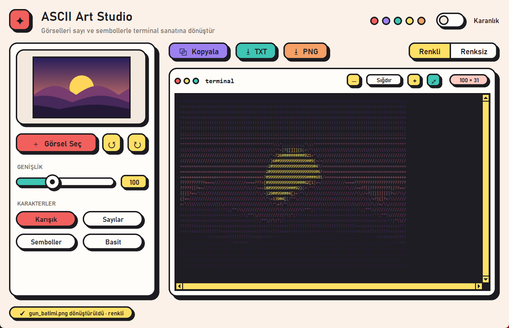
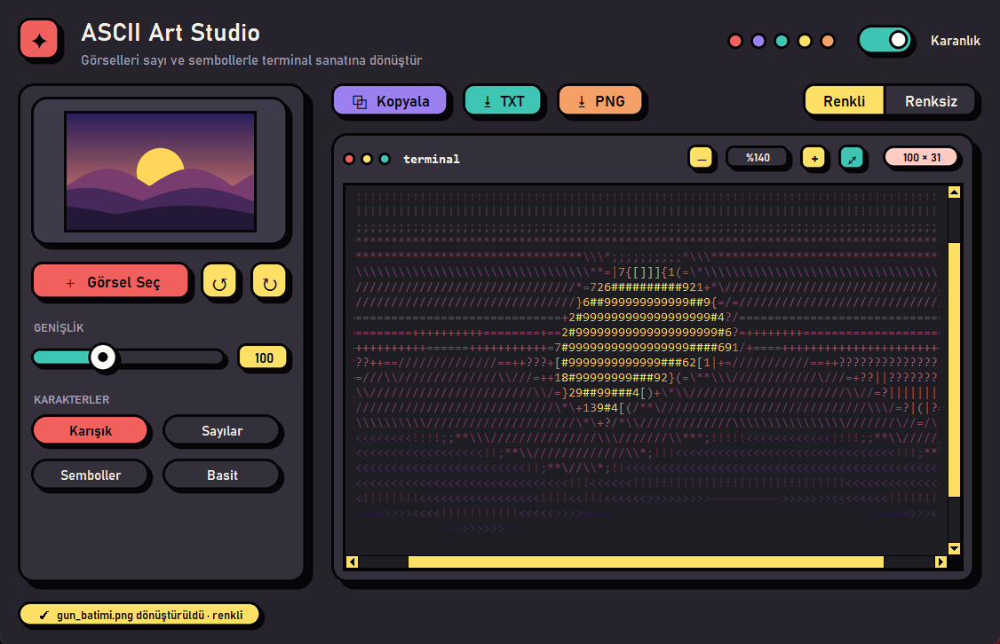

# ✦ ASCII Art Studio

Görselleri **sayı ve sembollerle** renkli ya da renksiz ASCII art'a dönüştüren, Neo Brutalism tasarımlı küçük bir masaüstü uygulaması. Çıktıyı panoya kopyalayabilir, terminalde renkli görünen bir `.txt` dosyası ya da `.png` resmi olarak kaydedebilirsin.





## Özellikler

- **Sürükle-bırak:** Görseli pencereye bırakman yeterli. İstersen **Görsel Seç** butonunu da kullanabilirsin.
- **Döndürme:** Görseli ↺ / ↻ butonlarıyla 90° sola ya da sağa çevirebilirsin.
- **Genişlik ayarı:** Çıktının kaç karakter genişliğinde olacağını (20–250) topuzlu kaydırıcıyla seçersin.
- **Karakter setleri:** Karışık, Sayılar, Semboller ve Basit. Karakterler, ekranda ne kadar dolu göründüklerine göre otomatik sıralanıyor.
- **Renkli / Renksiz** çıktı.
- **Yakınlaştırma:** −/+ butonları ya da Ctrl + tekerlekle büyütüp küçültebilirsin. Fareyle tutup sürükleyerek gezinirsin, ⤢ butonu görüntüyü panele sığdırır.
- **Dışa aktarma:**
  - **Kopyala:** düz metni panoya kopyalar.
  - **TXT:** renkli modda 24-bit ANSI renk kodlarıyla kaydeder. Dosyayı `type` / `cat` ile açınca terminalde renkli görünür.
  - **PNG:** çıktıyı resim olarak kaydeder.
- **Karanlık tema:** Seçimin bir sonraki açılışta hatırlanır.
- **Terminal modu:** Pencere açmadan sonucu doğrudan terminale yazdırır.

## Kurulum

### Hazır exe (Windows)

[Releases](https://github.com/huseyinbaranisik/ascii-art-studio/releases/latest) sayfasından `ASCII.Art.Studio.exe` dosyasını indirip çift tıklaman yeterli; Python kurulu olmasına gerek yok.

> Windows SmartScreen imzasız uygulamalar için uyarı gösterebilir. Bu durumda **Ek bilgi → Yine de çalıştır** seçeneğine tıkla.

### Kaynaktan çalıştırma

Python 3.10+ gerekir.

```bash
pip install -r requirements.txt
python ascii_art.py
```

## Terminal modu

```bash
python ascii_art.py resim.jpg --renkli --genislik 100 --karakter Sayılar
```

| Seçenek | Açıklama |
| --- | --- |
| `--renkli` | 24-bit renkli (ANSI) çıktı |
| `--genislik N` | Karakter cinsinden genişlik (varsayılan 100) |
| `--karakter` | `Karışık`, `Sayılar`, `Semboller` veya `Basit` |

## Exe oluşturma

```bash
pip install pyinstaller
python -m PyInstaller --noconfirm --onefile --windowed --name "ASCII Art Studio" --icon icon.ico --add-data "icon.ico;." ascii_art.py
```

Uygulama ikonunu değiştirmek istersen `make_icon.py` dosyasını düzenleyip çalıştırman yeterli. Bu betik `icon.ico` dosyasını her boyutu ayrı çizerek yeniden üretir.

## Proje yapısı

| Dosya | Görevi |
| --- | --- |
| `ascii_art.py` | Görseli ASCII'ye çevirme, dışa aktarma, uygulama penceresi ve terminal modu |
| `neo_ui.py` | Tkinter için Neo Brutalism bileşenleri: kalın kenarlı, keskin gölgeli butonlar, kartlar, kaydırıcı, anahtar ve tema renkleri |
| `make_icon.py` | `icon.ico` üretici |

Tkinter kendi başına keskin gölge ve pürüzsüz yuvarlak köşe çizemiyor. Bu yüzden bileşenler Pillow ile büyük boyutta çizilip küçültülüyor ve resim olarak gösteriliyor; böylece kenarlar yumuşak kalıyor.
