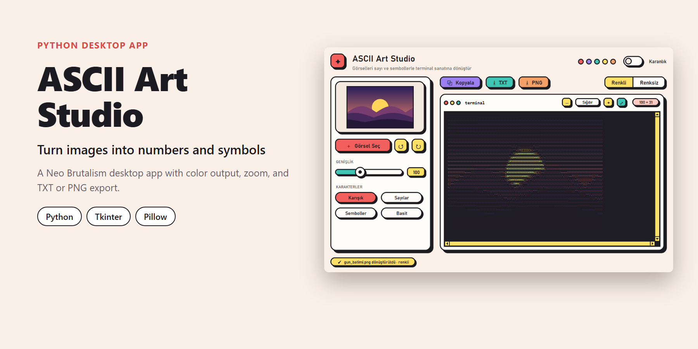
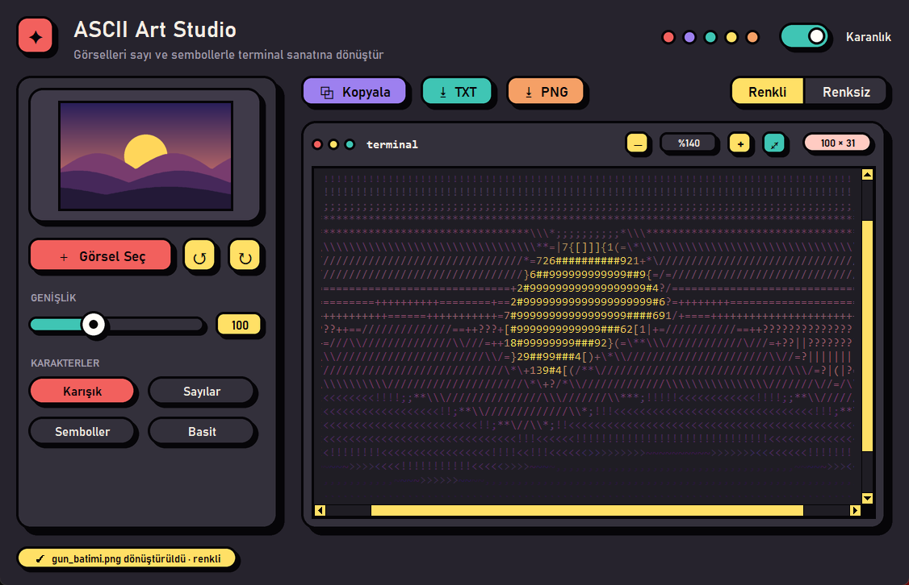

<p align="center">
  <a href="#demo">Demo</a> ·
  <a href="#what-it-does">What it does</a> ·
  <a href="#how-it-works">How it works</a> ·
  <a href="#run-it">Run it</a> ·
  <a href="#türkçe">Türkçe</a>
</p>

**ASCII Art Studio** is a small desktop app that turns images into colored or plain ASCII art made of numbers and symbols. Copy the result, save it as a terminal-ready `.txt`, or export it as a `.png`. The interface is in Turkish.

**Download:** `ASCII.Art.Studio.exe` from the [latest release](https://github.com/huseyinbaranisik/ascii-art-studio/releases/latest). Python is not required.

**Built with:** Python · Tkinter · Pillow · tkinterdnd2.

## Demo

<p align="center"></p>

<p align="center"><sub><b>Fig. 1</b> · The dark theme with a zoomed-in output.</sub></p>

## What it does

<table>
  <tr><td><b>Open images</b></td><td>Drag and drop onto the window, or use the image picker.</td></tr>
  <tr><td><b>Adjust</b></td><td>Rotate by 90° and set the output width from 20 to 250 characters.</td></tr>
  <tr><td><b>Character sets</b></td><td>Mixed, Numbers, Symbols and Simple, sorted automatically by visual density.</td></tr>
  <tr><td><b>Color</b></td><td>Switch between colored and plain output.</td></tr>
  <tr><td><b>Navigate</b></td><td>Zoom with the buttons or Ctrl + wheel, drag to pan, and fit to the panel.</td></tr>
  <tr><td><b>Export</b></td><td>Copy plain text, save TXT with 24-bit ANSI colors, or save PNG.</td></tr>
  <tr><td><b>Themes</b></td><td>Light and dark. Your choice is remembered.</td></tr>
  <tr><td><b>Terminal mode</b></td><td>Prints the result directly without opening a window.</td></tr>
</table>

## How it works

| File | Role |
|---|---|
| [`ascii_art.py`](ascii_art.py) | Conversion, export, the app window and terminal mode |
| [`neo_ui.py`](neo_ui.py) | Neo Brutalism widgets for Tkinter |
| [`make_icon.py`](make_icon.py) | Generates `icon.ico` |

Tkinter cannot draw hard shadows or smooth rounded corners by itself. The widgets are drawn large with Pillow, scaled down and shown as images, which keeps their edges clean.

## Run it

Python 3.10 or newer is required.

```bash
git clone https://github.com/huseyinbaranisik/ascii-art-studio.git
cd ascii-art-studio
pip install -r requirements.txt
python ascii_art.py
```

Terminal mode:

```bash
python ascii_art.py image.jpg --renkli --genislik 100 --karakter Sayılar
```

| Option | Meaning |
|---|---|
| `--renkli` | 24-bit colored ANSI output |
| `--genislik N` | Width in characters (default 100) |
| `--karakter` | `Karışık`, `Sayılar`, `Semboller` or `Basit` |

Build the exe:

```bash
pip install pyinstaller
python -m PyInstaller --noconfirm --onefile --windowed --name "ASCII Art Studio" --icon icon.ico --add-data "icon.ico;." ascii_art.py
```

> [!NOTE]
> Windows SmartScreen may warn about the unsigned exe. Choose **More info → Run anyway** to open it.

---

## Türkçe

**ASCII Art Studio**, görselleri sayı ve sembollerden oluşan renkli ya da renksiz ASCII art'a dönüştüren küçük bir masaüstü uygulaması. Sonucu kopyalayabilir, terminalde renkli görünen bir `.txt` ya da `.png` olarak kaydedebilirsin.

**İndir:** [Son sürümden](https://github.com/huseyinbaranisik/ascii-art-studio/releases/latest) `ASCII.Art.Studio.exe`. Python kurulu olması gerekmez.

**Teknoloji:** Python · Tkinter · Pillow · tkinterdnd2.

### Neler yapıyor

- **Görsel açma:** Sürükle-bırak ya da görsel seçici.
- **Ayar:** 90° döndürme ve 20–250 karakter arası genişlik.
- **Karakter setleri:** Karışık, Sayılar, Semboller ve Basit. Karakterler görsel yoğunluğa göre otomatik sıralanır.
- **Renk:** Renkli ya da renksiz çıktı.
- **Gezinme:** Butonlarla ya da Ctrl + tekerlekle yakınlaştırma, sürükleyerek gezinme, panele sığdırma.
- **Dışa aktarma:** Düz metni kopyala, 24-bit ANSI renkli TXT ya da PNG kaydet.
- **Tema:** Aydınlık ve karanlık, seçimin hatırlanır.
- **Terminal modu:** Pencere açmadan sonucu doğrudan yazdırır.

### Nasıl çalışıyor

`ascii_art.py` dönüştürme, dışa aktarma, pencere ve terminal modunu; `neo_ui.py` Neo Brutalism bileşenlerini; `make_icon.py` ise `icon.ico` dosyasını üretir. Tkinter keskin gölge ve pürüzsüz köşe çizemediği için bileşenler Pillow ile büyük çizilip küçültülür.

### Çalıştır

Python 3.10 veya üstü gerekir.

```bash
git clone https://github.com/huseyinbaranisik/ascii-art-studio.git
cd ascii-art-studio
pip install -r requirements.txt
python ascii_art.py
```

Terminal modu:

```bash
python ascii_art.py resim.jpg --renkli --genislik 100 --karakter Sayılar
```

Exe oluşturma:

```bash
pip install pyinstaller
python -m PyInstaller --noconfirm --onefile --windowed --name "ASCII Art Studio" --icon icon.ico --add-data "icon.ico;." ascii_art.py
```

> [!NOTE]
> Windows SmartScreen imzasız exe için uyarı gösterebilir. **Ek bilgi → Yine de çalıştır** seçeneğiyle açabilirsin.
